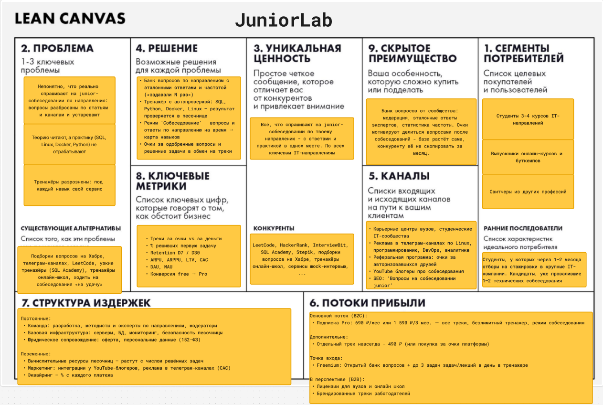

# JuniorLab

**Русскоязычная платформа подготовки к junior-собеседованиям в IT: вопросы по направлениям с эталонными ответами + тренажёр теории и практики с автопроверкой.**

- **Бизнес-модель:** B2C, в перспективе B2B
- **Домен:** EdTech / HRTech
- **Платформа:** Web

---

## Задание №1

### Elevator Pitch

Джуны в IT готовятся к собеседованиям вслепую: вопросы собирают по статьям на Хабре и телеграм-каналам, не понимают, что реально спрашивают на их позиции, а практику - SQL-запросы, команды Linux и Docker, задачи на Python - отрабатывают в разрозненных тренажёрах или не отрабатывают вовсе.

**JuniorLab** - русскоязычная платформа, где для каждого направления собраны вопросы, которые задают на junior-собеседованиях, с эталонными ответами, а рядом - тренажёр: ты пишешь ответ, запрос или команду, и система сразу проверяет результат в изолированной песочнице.

В отличие от LeetCode и подборок вопросов, у нас теория и практика по всему направлению собраны в одном месте, а вопросы добавляют сами пользователи после реальных собеседований - с отметкой, как часто их задают. За одобренные вопросы и решённые задачи начисляются очки, которые можно обменять на платные треки.

В результате кандидат знает, что его ждёт на собеседовании, закрывает пробелы на практике и приходит подготовленным.

Выбери своё направление - банк вопросов и первые задачи тренажёра доступны бесплатно.

### Направления

- **Backend** - Python, Go, Java, Kotlin, Swift, C, C++
- **Frontend** - JavaScript / TypeScript, React, Vue
- **Инфраструктура** - DevOps, DevSecOps, SRE
- **Безопасность** - SOC L1, пентест, AppSec
- **Тестирование** - Manual QA, Automation QA
- **Аналитика** - системный, продуктовый, бизнес-аналитик

На старте запускаются 3 трека: **Python Backend, DevOps и аналитика (SQL)**. Остальные добавляются по мере роста базы и сообщества.

### Lean Canvas

